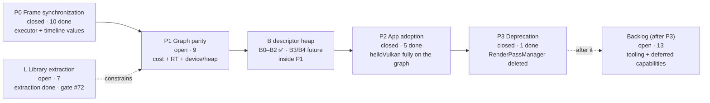
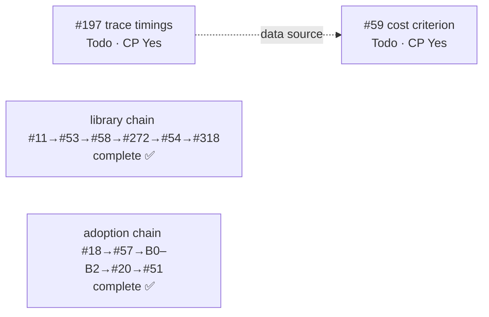

# Roadmap: a visualized snapshot

**Snapshot:** 2026-11-26, master `e79d909`, after the #318 repository split and the post-split sync
audit. **Adoption is complete and the library is extracted:** this repository builds `muyo_rg`,
`muyo_device` and a test-only `muyo_debug`; the renderer (host, apps, pipeline, renderer-coupled
tests, shaders, assets) lives in [muyo-renderer](https://github.com/v3c70r/muyo-renderer). P0, P2 and
P3 are closed milestones; P1, L and Backlog remain open with **29 open issues** (P1 9, L 7,
Backlog 13 — every open Muyo issue now carries a milestone). The board also carries **15 open
muyo-renderer issues**, which have no milestones of their own. The B track is complete through B2.

**Authority:** phase membership is the six GitHub milestones; an issue's state is its `Status`,
`Critical path`, `Depends on` and `Debt` fields on the [project board](https://github.com/users/v3c70r/projects/3);
the reasoning is [`Roadmap.md`](Roadmap.md), and the consumer contract is [`Consumers.md`](Consumers.md).
This file holds none of that. It is a **view** plus the record of the reconciliation that produced it.
When the board moves, regenerate it - do not treat a diagram here as a commitment.

It is a separate file because `Roadmap.md` deliberately does not list phase members (its "Where the plan
lives" section); a diagram that listed them inside that document would recreate the duplication it warns
about. The view lives here so the contract there stays true.

---

## 1. Phases and gates



| Phase | Gate (from the milestone description) | State |
| --- | --- | --- |
| **P0** | Executor runs N in-flight executions; completion is per-queue timeline values; no frame boundary on the execution path. | **Met, closed.** 10 done, 0 open. |
| **P1** | The graph renders the scene validation-clean with the capabilities (transfer/clear, transients, descriptors, pipeline caching). RT is a separate gate. The cost half is #59. | **Open, 9.** Adoption is complete; the app is fully graph-driven in muyo-renderer. Remaining: #59 cost (must choose a new reference because the legacy path is gone) with its timing source #197, the RT cluster #19/#223/#238 (#253 closed with #307), and device/heap follow-ups #222/#233/#234/#262 (#265 closed). |
| **P2** | `helloVulkan` renders through the graph; `RenderPassManager` is referenced only by its own files. Capability, not completeness. | **Met, closed.** 5 done, 0 open; the manager was deleted with #51. |
| **P3** | `grep -rn "RenderPassManager" src/` is empty and `src/RenderPasses/` is gone; the diff is almost entirely deletions. | **Met, closed.** 1 done, 0 open (#51). |
| **L** | A non-renderer consumer runs against the public surface only, with no `gap` row blocking it. | **Open, 7.** The extraction itself is done (#318): the public surface is stated (#53), the device (#58/#277) and resource/allocator (#272/#285) boundaries landed, in-tree no-renderer coverage landed (#54/#288), the package installs (#73), SPIR-V-from-memory is a service (#292). The one remaining `gap` row in Consumers.md is **#72** (cooperative-matrix property fetch crashes on NVIDIA + VVL 1.4.363), so the gate does not close. The other six are library-surface/consumer work riding the track: #80, #283, #293, #321, #324, #325. |
| **Backlog** | Work the roadmap places after the first consumer adoption (complete) and P3. | **Open, 13.** None on the parity path. |

### B track inside P1

| Slice | Scope | State |
| --- | --- | --- |
| B0 (#213) | Device features, heap properties, function pointers, standalone probe, AS/RT decision | **Landed.** Same `.heap.spv` on RADV, RTX 3090 and qualifying llvmpipe; RTX 3090 RT gaps are #223/#238. The probe now lives in muyo-renderer's suite (#318). |
| B1a (#215) | `DescriptorHeapService`, typed regions, static + per-execution rings, sampler lifecycle | **Landed.** Descriptors read through push data with no descriptor set/layout/pipeline layout. |
| B1b (#216) | Graph bind: `PushData`, heap index resolver, null-layout pipelines, remove descriptor-set code | **Landed.** Graph suite green; no descriptor-set/pipeline-layout calls in `src/RenderGraph/`. |
| B2 (#217) | Per-frame build, descriptor/root rings, in-flight above 1, #17/#209/#40/#83 | **Landed** (#254). #20/#51 followed; #59 is the remaining cost item. |
| B3/B4 | Unified layouts deferred; GPU-written root optional | Deferred/optional, no work now. |

## 2. Critical path

The field has **2 open items**: P1's cost pair. The library chain and the adoption chain are complete;
closed items clear their mark (the library chain's four were cleared in this audit, R40).



- **P1 closure** — `#197` supplies the timings; `#59` owns the method and tolerance. `#59` must name a
  reference now that the legacy path is deleted: a frozen `e584d45` worktree (with the IBL/RSM confound
  stated) or a hand-written same-four-passes harness.
- Everything else (RT, heap follow-ups, L track, Backlog) is `Critical path: No` by the project's
  scoping rule.

## 3. Where the next work is

1. **Close P1's cost (#59).** Choose the post-adoption reference, measure on both machines, set a
   tolerance. #197 is the timing source; #59 can start against wall clock.
2. **The L gate (#72).** The cooperative-matrix property fetch that crashes on NVIDIA + VVL 1.4.363 —
   the last `gap` row in Consumers.md. The extraction itself is done; this is what keeps L open.
3. **Library surface and coverage.** #293 (VMA types off the public interface), #324 (retire the device
   globals), #325 (de-duplicate `src/Debug` with the renderer), #321 (restore library-side coverage for
   the six library-subject tests that moved in #318), #283 (muyo-llm migrates to the graph-owned
   allocator — the consumer still builds against the pre-#272 field; coordinate with #324).
4. **RT, only with a consumer or when scheduled.** #19 hardening, #223 (RTX 3090 device loss), #238
   (zero hits + teardown hang). These block a graph RT rebuild, not the deleted legacy path.
   muyo-renderer#18 is the Windows/RTX 3060 sibling of #223's shape.
5. **Heap follow-ups.** #222 (custom-border sampler indices), #233 (NVIDIA member offsets), #234 (lazy
   builder-owned heap), #262 (NVIDIA array-member reads).
6. **Backlog and renderer.** Muyo: tooling #25/#157/#183/#314/#322/#332, device correctness
   #281/#284/#287/#290, #144 multisampling, #188 plan-diagram granularity, #303 RenderDoc wait.
   muyo-renderer: CI (#4), main protection (#12, ruleset landed, invite pending), asset migrations
   (#1/#2/#21), app defects (#14/#16/#19/#20), capture (#15), build hygiene (#13/#22), device-line
   fallback (#5), Windows RT device loss (#18).

## 4. Open issues, by milestone

| Milestone | # | Area | CP |
| --- | --- | --- | --- |
| P1 | #19 A7 RT hardening | Ray tracing | No |
| P1 | #59 cost criterion | Performance | **Yes** |
| P1 | #197 trace timings | Performance | **Yes** |
| P1 | #222 sampler index reuse | Descriptors | No |
| P1 | #223 RTX 3090 device loss | Ray tracing | No |
| P1 | #233 NVIDIA member offsets | Descriptors | No |
| P1 | #234 lazy builder heap | Descriptors | No |
| P1 | #238 RTX 3090 zero hits / hang | Ray tracing | No |
| P1 | #262 NVIDIA array-member reads | Descriptors | No |
| L | #72 cooperative-matrix NULL dispatch | Device | No |
| L | #80 8-bit storage / shaderInt8 | Device | No |
| L | #283 muyo-llm allocator migration | Adoption | No |
| L | #293 VMA types off public surface | Graph API | No |
| L | #321 restore library-side coverage | Tooling | No |
| L | #324 retire device globals | Graph API | No |
| L | #325 de-duplicate src/Debug | Tooling | No |
| Backlog | #25 `-Wconversion` / scan-build | Tooling | No |
| Backlog | #144 multisampling | Lifetime | No |
| Backlog | #157 test suite GPU fallback | Tooling | No |
| Backlog | #183 TSan report count | Tooling | No |
| Backlog | #188 plan-diagram granularity | Graph API | No |
| Backlog | #281 allocator Unintialize dangling | Device | No |
| Backlog | #284 capability flags after fallback | Device | No |
| Backlog | #287 RT allocator requires RT feature | Device | No |
| Backlog | #290 debug-marker runtime coverage | Device | No |
| Backlog | #303 RenderDoc heap support wait | Tooling | No |
| Backlog | #314 docs deploy job split | Tooling | No |
| Backlog | #322 per-config archive dirs | Tooling | No |
| Backlog | #332 audit query host key | Tooling | No |

### muyo-renderer issues (no milestones; state is the Status field)

| # | Title | Origin |
| --- | --- | --- |
| #1 | tinygltf v3 migration, unpin submodule | filed in renderer |
| #2 | KTX2 texture loading via libktx | filed in renderer |
| #4 | CI for muyo-renderer | filed in renderer |
| #5 | `[test device]` line vs mid-run fallback | filed in renderer; complements Muyo#157 |
| #12 | protect main + reviewer write access | ruleset landed 2026-11-26; invite pending |
| #13 | GLM include dir on the link line | filed from #10 review |
| #14 | Camera::Resize discards projection | transferred from Muyo#186 |
| #15 | RenderDoc on Wayland | transferred from Muyo#220 |
| #16 | X11 close crash | transferred from Muyo#260 |
| #17 | glTF light range | transferred from Muyo#279 |
| #18 | Windows Debug+RT device loss | transferred from Muyo#309; sibling of Muyo#223 |
| #19 | camera drags ignore ImGui capture | transferred from Muyo#312 |
| #20 | DPI-aware screenshots | transferred from Muyo#316 |
| #21 | tinyobjloader unpin | transferred from Muyo#323; sibling of #1 |
| #22 | per-config output dirs | filed in renderer; sibling of Muyo#322 |

## 5. Dependencies

- `#197 → #59`: #59 consumes the timings, but can start against wall clock and switch one function.
- `#19 / #223 / #238`: the RT cluster; all block a graph RT rebuild, none blocks the raster frame.
  muyo-renderer#18 is the same device-lost shape on Windows/RTX 3060; a confirmed library root cause
  lands in Muyo, and #321 would restore a library-side repro.
- `#283` coordinates with `#324`: the same muyo-llm file uses `GetRenderDevice()` and the old
  `.resourceManager` field.
- `#157 ↔ muyo-renderer#5`: the library pin-and-warn root cause vs the renderer fixture's device line;
  complementary, not duplicates.
- `#322 ↔ muyo-renderer#22`: the same shared-output-dir pattern in each repository's CMakeLists.
- `#321` option 2 (renderer-owned coverage) would link muyo-renderer#4's CI.

## 6. Reconciliation findings (2026-11-26, post-split sync)

Earlier rounds (R1–R36) are in the file's history; this pass regenerated the snapshot after the #318
split and audited both repositories' issues, milestones, board fields and descriptions.

| # | Finding | Evidence | Action |
| --- | --- | --- | --- |
| R37 | The snapshot was pre-split: 26 open issues, CP 6, L described as in progress. | Milestone query: P1 9, L 2→7, Backlog 10→13; #53/#54/#58/#272/#73/#87 closed. | Regenerated: 29 open, all milestoned; CP 2; library chain marked complete. |
| R38 | Eight renderer-subject issues were filed in Muyo. | Subject code verified in muyo-renderer (Camera.h, SceneImporter.cpp, helloVulkan.cpp, WindowGLFW.h, the renderer suite, the pinned submodules). | Transferred to muyo-renderer#14–#21 with per-issue evidence comments; cross-references cleaned (warning-baseline, AGENTS §5, `TODO(#279)`→#17, renderer README, Capture.md). |
| R39 | #289 (CI runs rg_tests) and #317 (tidy project/vendored split) were already satisfied on master. | ci.yml:220/264/341; sanity.sh:176-182. | Verified mechanically and closed. |
| R40 | Four closed library-chain issues still carried `Critical path: Yes` (#53, #54, #58, #272). | Board query. | Cleared per the closed-clears rule; the field now has 2 open items. |
| R41 | 18 open issues had no milestone. | Issue list. | Assigned: L 5 (#283/#293/#321/#324/#325), Backlog 7 (#281/#284/#287/#290/#314/#322/#332); 4 transferred, 2 closed. |
| R42 | Repo description ("A Toy Vulkan Renderer"), project README ("zero production adoption") and shortDescription were pre-split. | gh repo/project view. | Rewritten: library identity, current state, CP 2. |
| R43 | L milestone description cited closed gap rows (#53) and "muyo_rg cannot link standalone"; P1 description listed closed #253/#265. | Milestone descriptions vs Consumers.md. | Rewritten; gates unchanged (L still open over #72). |
| R44 | muyo-renderer had no ruleset and qgu-reviewer no write access — approvals could not count. | rulesets/collaborators API. | Mirrored Muyo's ruleset (main: PR + review, squash only, id 28191638); invited qgu-reviewer with write (pending acceptance); tracked as renderer#12. |
| R45 | The renderer's CMakeLists repeats #322's shared-output-dir pattern, untracked; #322's shaders/CWD clause is stale for Muyo. | renderer CMakeLists:25-29; measured LNK2038 during #10 verification. | Filed muyo-renderer#22; cross-linked both. |
| R46 | Muyo README still said "useless renderer"; warning-baseline carried the departed `src/Camera.h`. | README.md; warning-baseline.txt:16. | README rewritten as the library's; baseline emptied with the history recorded. |

## 7. Refreshing this view

```bash
# phase counts and open issues
gh api 'repos/v3c70r/Muyo/milestones?state=all&per_page=100' \
  --jq '.[] | "\(.title) state=\(.state) open=\(.open_issues) closed=\(.closed_issues)"'

gh issue list --state open --limit 100 --json number,title,milestone \
  --jq '.[] | "#\(.number) \(.milestone.title // "-") \(.title)"'

# critical-path count: expect 2 at this snapshot.
# Board reads need the read:project scope (`gh auth refresh -s read:project`); without it this call
# fails with "Could not resolve to a node..." — that is a missing scope, not an empty board.
gh api graphql -f query='query($p:ID!,$q:String){ node(id:$p){ ... on ProjectV2 {
  items(first:100,query:$q){ totalCount } } } }' \
  -f p=PVT_kwHOACw01s4BmAfF -f q='critical-path:Yes' --jq '.data.node.items.totalCount'

# source measurements at this snapshot
cat $(find src/RenderGraph -name '*.cpp' -o -name '*.h') | wc -l   # 9,679
grep -rnE 'GetRenderDevice\(\)|GetRenderResourceManager\(\)|GetDescriptorManager\(\)' \
  --include=*.cpp src/RenderGraph/ | wc -l                          # 0 since #272/#318

# External includes from src/RenderGraph/*.h|cpp; expect 9 files, every header under src/RenderDevice/.
python3 - <<'PY'
import os, glob, re
d = 'src/RenderGraph'
local = set(os.listdir(d))
for f in sorted(glob.glob(d + '/*.h') + glob.glob(d + '/*.cpp')):
    inc = [m.split('/')[-1] for m in re.findall(r'^\s*#include\s+"([^"]+)"', open(f, encoding='utf-8').read(), re.M)]
    ext = [h for h in inc if h not in local and not h.startswith('vulkan')]
    if ext:
        print(f, '->', ' '.join(sorted(set(ext))))
PY
```

The singleton-site command is in `Roadmap.md`; the external-include scan is above. A copied command is a second place to rot, so the measurement lives where the claim is made.

A number in this file is a measurement with a date. If it is wrong, the fix is the command, not the
sentence.
