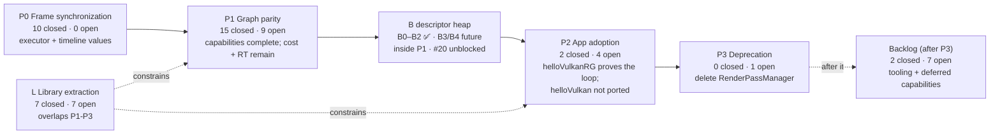
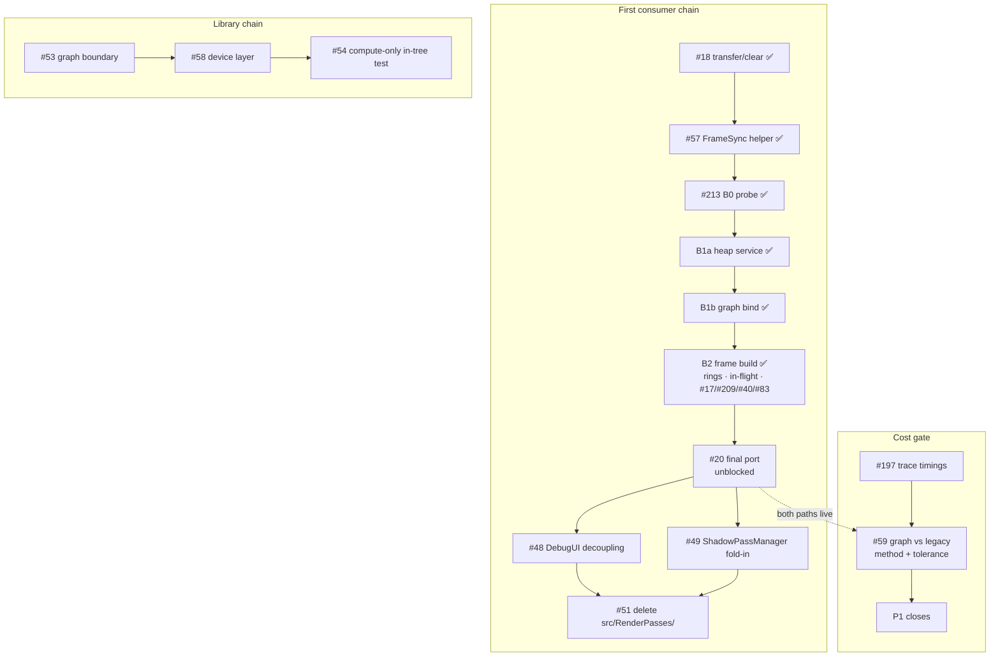
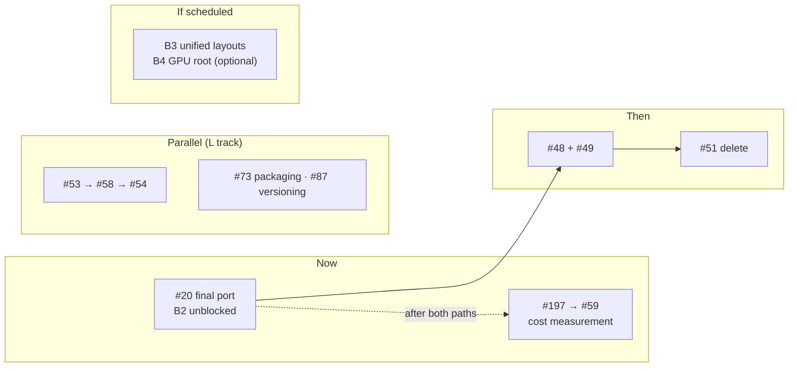
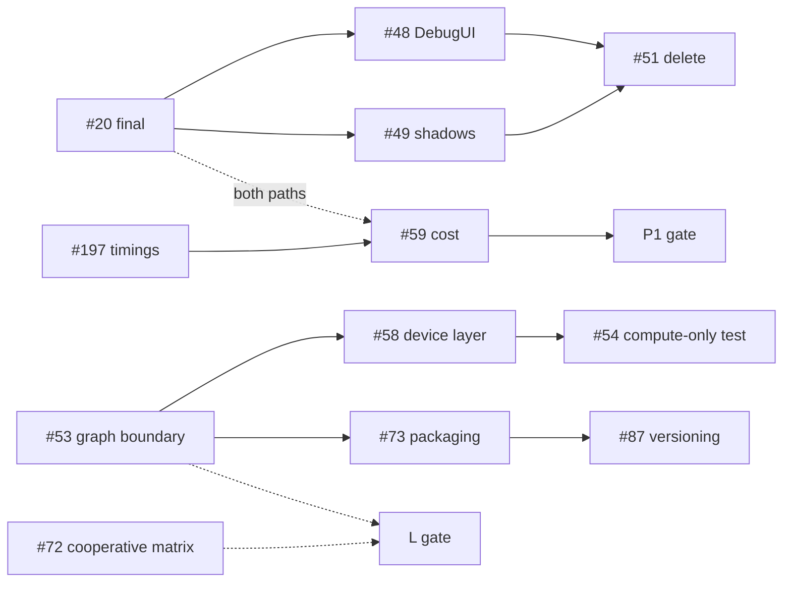

# Roadmap: a visualized snapshot

**Snapshot:** 2026-10-28, master `1896bae`. B2 landed (#254): #40/#83/#217 closed, and the B track's
B0–B2 are complete. #212 closed per its exit clause; #15 (descriptor-set fallback) and #57 (frame helper)
closed as done or superseded. B3/B4 remain deferred/optional. Afterwards the board was reconciled
(28 open issues, each with a milestone and a `Critical path` value).

**Authority:** phase membership is the six GitHub milestones; an issue's state is its `Status`,
`Critical path`, `Depends on` and `Debt` fields on the [project board](https://github.com/users/v3c70r/projects/3);
the reasoning is [`Roadmap.md`](Roadmap.md), and the consumer contract is [`Consumers.md`](Consumers.md).
This file holds none of that. It is a **view** plus the record of the reconciliation that produced it.
When the board moves, regenerate it - do not treat a diagram here as a commitment.

It is a separate file because `Roadmap.md` deliberately does not list phase members (its "Where the plan
lives" section); a diagram that listed them inside that document would recreate the duplication it warns
about. The view lives here so the contract there stays true.

---

## 1. Phases and gates



| Phase | Gate (from the milestone description) | State |
| --- | --- | --- |
| **P0** | Executor runs N in-flight executions; completion is per-queue timeline values; no frame boundary on the execution path. | **Met** — 0 open. Its note that the builder stayed at `inFlightCount == 1` is historical: #40 landed in B2 (#254) and overlap is no longer a P0 item. |
| **P1** | A scene renders through the graph, validation-clean, every capability (transfer/clear, transients, descriptors, pipeline caching) matching the legacy path; RT is a separate gate. The cost half is #59. | **In progress.** Capabilities are complete: #18/#16/#17 landed, #15 closed as superseded, and B0–B2 landed. Remaining: #59 (cost) and the RT gate (#19/#223/#238); heap follow-ups #222/#233/#234. |
| **P2** | `helloVulkan` renders through the graph; `RenderPassManager` is referenced only by its own files. Capability, not completeness. | **Started** (helloVulkanRG, #112/#113). B2 landed, so the final #20 port is unblocked; #48/#49 must land before #51. |
| **P3** | `grep -rn "RenderPassManager" src/` is empty and `src/RenderPasses/` is gone; the diff is almost entirely deletions. | **Blocked on P2 + #48 + #49.** |
| **L** | A non-renderer consumer runs against the public surface only, with no `gap` row blocking it. | #53 (public surface, SPIR-V bytes) and #72 (cooperative-matrix fetch) are the remaining blockers. #55 and #16 landed, so their `gap` rows are `holds`. |
| **Backlog** | Work the roadmap places after the first consumer is adopted: tooling adoption, diagnostics, deferred capabilities. | **Parked.** 7 open, none on the parity path. |

### B track inside P1

| Slice | Scope | State |
| --- | --- | --- |
| B0 (#213) | Device features, heap properties, function pointers, standalone probe, AS/RT decision | **Landed.** Same `.heap.spv` on RADV, RTX 3090 and qualifying llvmpipe; RTX 3090 RT gaps are #223/#238, recorded rather than green. |
| B1a (#215) | `DescriptorHeapService`, typed regions, static + per-execution rings, sampler lifecycle | **Landed.** Descriptors read through push data with no descriptor set/layout/pipeline layout. |
| B1b (#216) | Graph bind: `PushData`, heap index resolver, null-layout pipelines, remove descriptor-set code | **Landed.** Graph suite green; no descriptor-set/pipeline-layout calls in `src/RenderGraph/`; UI renders. |
| B2 (#217) | Per-frame build, descriptor/root rings, in-flight above 1, #17/#209/#40/#83 | **Landed** (#254): resize/swapchain build per frame; #209/#17 landed; #40's overlap test and #83's per-execution bindings closed. |
| B3/B4 | Unified layouts deferred; GPU-written root optional | No work scheduled; they get their own issues if scheduled. |

The B track is not a phase; it was a gated workstream inside P1. B0–B2 landed before the final #20 port;
#212 closed on that exit. There is no G track.

## 2. Critical path



`#59` is drawn across the consumer chain rather than in it: nothing waits for it, but P1 cannot close
without its number. Its measurement needs **both** renderers alive, so the window is after the final #20
and before #51.

The B track is finished: B0 → B1a → B1b → B2 all ✅, then the final #20. #15 closed as superseded;
#16/#12 are closed; #83/#40 closed with B2. #48/#49 are now marked `Critical path: Yes` because the
diagram has always shown them between #20 and #51, and their slippage moves P3's end date.

## 3. Where the next work is



Why this order:

1. **The final #20 next.** B2 removed the freeze; the heap-only path, per-frame `Build()` and two-frame
   overlap are in place. #111's UI pass stays accepted double-conversion debt.
2. **Then #48/#49 → #51.** The deletion waits for the DebugUI and shadow passes to leave
   `RenderPassManager`.
3. **#197 → #59 runs across both.** It needs both renderers alive, so it follows the port and precedes the
   deletion.
4. **The L track runs in parallel**, unchanged.
5. **B3/B4 are not scheduled.** B3 is driver-gated; B4 is optional.

## 4. Open issues, by area

Twenty-eight issues are open. `CP` is the `Critical path` field; `Deps` is the `Depends on` field.

| # | Area | Milestone | Status | CP | Deps | Note |
| --- | --- | --- | --- | --- | --- | --- |
| 19 | Ray tracing | P1 | Todo | No | - | RT hardening; the RT gate is separate from raster parity. |
| 20 | Adoption | P2 | In Progress | **Yes** | - | Final `helloVulkan` port; B2 unblocked it. |
| 25 | Tooling | Backlog | Todo | No | - | Remaining `-Wconversion` + scan-build baseline. |
| 48 | Adoption | P2 | Todo | **Yes** | - | DebugUI decoupling; blocks #51. |
| 49 | Adoption | P2 | Todo | **Yes** | - | ShadowPassManager into the graph; blocks #51. |
| 51 | Adoption | P3 | Todo | **Yes** | #20 | Deletion only. |
| 53 | Graph API | L | In Progress | **Yes** | - | Services injected; header split, standalone build, packaging remain. |
| 54 | Graph API | L | Todo | **Yes** | #58 | In-tree compute-only plan test. |
| 58 | Device | L | Todo | **Yes** | #53 | Device target + validation policy to the host. |
| 59 | Performance | P1 | Todo | **Yes** | #197 | Cost criterion; needs both renderers alive. |
| 72 | Device | L | Todo | No | - | VVL/cooperative-matrix crash. |
| 73 | Tooling | L | Todo | No | #53 | Install rules/export set. |
| 80 | Device | L | Todo | No | - | 8-bit storage; consumer-triggered. |
| 87 | Tooling | L | Todo | No | - | Version, changelog, deprecation mechanism. |
| 144 | Lifetime | Backlog | Todo | No | - | Multisampling in `ImageResourceDesc`. |
| 157 | Tooling | Backlog | Todo | No | - | Mid-suite device fallback. |
| 183 | Tooling | Backlog | Todo | No | - | TSan report-count enforcement. |
| 186 | Adoption | P2 | Todo | No | - | `Camera::Resize` drops the new projection. |
| 188 | Graph API | Backlog | Todo | No | - | Plan-diagram granularity for consumers. |
| 197 | Performance | P1 | Todo | **Yes** | - | Trace timings; feeds #59. |
| 219 | Tooling | Backlog | Todo | No | - | WindowGLFW init result discarded; start-up errors collapse into one. |
| 220 | Tooling | Backlog | Todo | No | - | RenderDoc/Wayland capture stops advertising the WSI extension; no recipe. |
| 222 | Descriptors | P1 | Todo | No | - | Ring custom-border samplers must reuse an index or reject. |
| 223 | Ray tracing | P1 | Todo | No | - | RTX 3090 heap RT trace loses the device. |
| 233 | Descriptors | P1 | Todo | No | - | NVIDIA heap Slang member reads drop non-zero struct offsets. |
| 234 | Descriptors | P1 | Todo | No | - | Create the builder-owned heap service lazily. |
| 238 | Ray tracing | P1 | Todo | No | - | RTX 3090 heap RT: zero hits, teardown hang. |
| 253 | Ray tracing | P1 | Todo | No | - | B2 follow-up: an owned RT pipeline is destroyed while an execution may use it. |

## 5. Dependencies



The B track no longer appears: B0–B2 are closed, #15 is closed, and #40/#83 closed with B2. The heap
follow-ups (#222/#223/#233/#234/#238/#253) are inside P1 but have no edges into the consumer chain.

## 6. Reconciliation findings

Each finding was checked against the repository or the board on 2026-10-22; R16–R18 on 2026-10-26; R19–R28
on 2026-10-28. The action is what this branch and the corresponding issue/field edits do.

| # | Finding | Evidence | Action |
| --- | --- | --- | --- |
| R1 | `Roadmap.md` "Where we are" line counts are stale. | `src/RenderGraph` was **7,466** lines (doc said 3,777); `src/RenderPasses` 4,412 (4,403); `helloVulkan.cpp` 376 (374). | Updated the table. |
| R2 | "The graph has zero production adoption" overstates it now. | `helloVulkan` is still legacy, but `src/app/helloVulkanRG.cpp` owns its frame loop through the graph, and `muyo-llm` is an external non-renderer consumer. | Reworded: zero **in-repo renderer** adoption; helloVulkanRG + muyo-llm exercise it. |
| R3 | `#83` is in `Backlog (after P3)`, but its design trigger is **after #20** (P2), which is before P3. | Design note (#211) status section; #83 body update. | Moved #83 to P2; B2 owns the execution-binding half. |
| R4 | `Consumers.md` lists "Declaration errors fail at `Build()`, naming the graph entity" as a **gap** owned by #55 - but #55 is closed. | #55 closed; the failure-index work closed as completed in the batches #127/#128/#131/#132/#135/#142 (issues, not PRs). | Row becomes `holds`. |
| R5 | The L milestone description says #55 and #16 block the gate; both are closed. | #16 and #55 are closed; the remaining gap rows are #53 (two) and #72. | Updated the milestone description. |
| R6 | `#40`'s body says descriptor sets are written at record time and depends on #15/#16/#11. Since #15's cache, sets are written at `Build()`; #16 and #11 are closed. | `docs/RenderGraph.md` status bullet says the record-time hazard is gone; the remaining alias is transients. | B2 replaces the descriptor-set half with root data; per-execution transients remain. |
| R7 | `#17` has `Critical path: No`, but the P1 gate names pipeline caching as a capability P1 cannot close without. | P1 milestone description. | Set `Critical path: Yes` (slippage moves P1's close). |
| R8 | `#53`'s measurements are stale (13 files / 15 call sites / "no `target_link_libraries`"), and it still depends on #11 (closed). | Now **8** files under `src/RenderGraph/` include at least one header from outside the directory (scan in section 7), **2** singleton code call sites in the transitional constructor (+3 doc lines), and `muyo_rg` has `target_link_libraries(PUBLIC muyo)`. | Updated #53's body; cleared the closed dependency. |
| R9 | `#25` is titled "Enable -Wextra ...", but `-Wextra` and the warning baseline landed (#193/#194). Only `-Wconversion` measurement and the scan-build baseline remain. | #25's own status section. | Retitled to the remaining scope; kept `Debt: After P3`. |
| R10 | Seven open issues have **no milestone**, so the Roadmap's "milestone owns the phase" contract does not cover them: #144, #157, #183, #186, #188, #197, #209. | `gh issue list` vs milestones. | Assigned: #197/#209 to P1, #186 to P2, #144/#157/#183/#188 to Backlog. |
| R11 | The `Depends on` field for #59 is empty although #59 consumes #197's timing data; #57 listed closed #16 and then the #15 fallback. | #59 body, #197 body, #57 board field. | Set #59 → #197; cleared #57 to none — #15 is a fallback, not a gate. |
| R12 | `docs/RenderGraph-Library-Design.md` still says `muyo_rg` declares no dependencies, while it now links the engine. | `CMakeLists.txt:367 target_link_libraries(muyo_rg PUBLIC muyo)`. | Corrected the sentence: the remaining gap is standing alone, not declaring nothing. |
| R13 | The Roadmap's "Not on the parity path" table still lists #22/#24 (closed) and #25 (landed except two items). | #22 and #24 closed; #25 status section. | Table updated: #25's remaining scope only. |
| R14 | P0 has 0 open issues but the milestone is still open. | Milestone counts. | Left open as a grouping device; noted here so it is a decision rather than an oversight. |
| R15 | The Roadmap's Risk 5 says CI gates "formatting"; CI now also runs the changed-line clang-tidy gate. | `.github/workflows/ci.yml` has a `clang-tidy (changed lines)` job and 7 jobs total. | Added to Risk 5. |
| R16 | The roadmap still described the descriptor path as #15 and referenced PR #208 as the execution-bindings design. #211 merged the descriptor-heap design and #208 closed. | `docs/DescriptorHeap-Bindless-Design.md`; PR #211; issue #208. | Added B0–B4 to `Roadmap.md`, added the B track to the visual, and moved #83/#40 references to #211/B2. |
| R17 | P1 count and total open issues changed when the B tracking and B0 issues were filed. | Milestones: P1 open 9; 28 open total. | Updated the snapshot, phase counts and issue table. |
| R18 | #20 has in-flight work (#111 UI) but no freeze statement; the roadmap read as if porting had not started. | #111 merged; #20 open. | Recorded #111 as accepted double conversion and froze further ports until B2. |
| R19 | B2 and the B track landed, but `Roadmap.md` still said "B0 is the next code slice", "no graph code has changed yet", and "further ports freeze until B2"; the design note still said "design draft, not implemented". | #213/#215/#216/#217 closed; #254 merged at `1896bae`; design note status line. | Updated `Roadmap.md` (Where we are, B track, critical path, risks 1 and 6) and the design note's status/critical-path paragraphs. |
| R20 | Seven closed B2/B-track issues still had `Critical path: Yes` (#16, #17, #213, #215, #216, #217), contradicting the documented rule that a closed issue clears its mark. #48/#49 were on the diagram but `No`. | Board fields vs the "A closed issue clears its mark" rule in `Roadmap.md`. | Cleared the closed items; set #48/#49 to `Yes` so the field matches the diagram. |
| R21 | #212's own Exit says it closes when B2 lands; it was still `In Progress`. | #212 body; B2 merged. | Closed with a pointer to B0–B2 and the B3/B4 disposition; board `Done`. |
| R22 | #15's status note says to close it once the graph no longer uses descriptor sets; it was still open in P1. | Graph path has had no descriptor sets since B1b; #15 body. | Closed as superseded; board `Done`. |
| R23 | #57's helper landed (#110/#113) and `helloVulkanRG` uses it with two frames in flight, but the issue was still `In Progress`; #20 still listed it as a dependency. | `src/FrameSync.{h,cpp}`; `helloVulkanRG`; #57 body acceptance. | Closed #57; cleared #20's `Depends on`. |
| R24 | Six open issues had no milestone and two had a blank/wrong Area. | #219/#220/#233/#234/#238/#253 vs milestones; #219 `Device`, #233 blank. | #219/#220 → Backlog, #233/#234/#238/#253 → P1; #219 Area Tooling, #233 Area Descriptors. |
| R25 | The measurement claims in R1/R8 were stale again: `src/RenderGraph` grew, `helloVulkanRG` grew, and `PipelineCache.cpp` added a ninth external-include file; the singleton code site count fell to 1. | Section 7 commands: 8,311 / 4,412 / 376 / 426; 9 external-include files; 1 singleton call site. | Updated the table and section 7's trailing counts. |
| R26 | #226 was closed but its board item still read `In Progress`. | `gh issue view 226` vs board status. | Set the board item to `Done`. |
| R27 | Milestone descriptions were stale: P0 said the builder stays at `inFlightCount == 1`; P1 said #40 depends on #15/#16; Backlog listed closed #22/#24. | Milestone descriptions. | Updated P0/P1/P2/Backlog descriptions; the gates themselves are unchanged. |
| R28 | #20's body still read as if the loop port were blocked and folded the deletion into its scope. | #20 body; B2 landed; #51 owns deletion. | Commented on #20 with the freeze lifted and the remaining scope; left the issue open as the port. |

## 7. Refreshing this view

```bash
# phase counts
gh api 'repos/v3c70r/Muyo/milestones?state=all&per_page=100' \
  --jq '.[]|"\(.title): open=\(.open_issues) closed=\(.closed_issues)"'

# issue state, including the custom fields (the key has a space: "critical path"). Board reads need
# the read:project scope (gh auth refresh -s read:project); without it the command fails, which is not
# the same as an empty board.
gh project item-list 3 --owner v3c70r --limit 200 --format json \
  | python3 -c 'import json,sys; [print(i["content"]["number"], i.get("status"), i.get("critical path"), i.get("depends on")) for i in json.load(sys.stdin)["items"] if i.get("content",{}).get("number")]'

# the measurement claims in section 6
cat $(find src/RenderGraph -name '*.cpp' -o -name '*.h') | wc -l
grep -rnE 'GetRenderDevice\(\)|GetRenderResourceManager\(\)|GetDescriptorManager\(\)' --include=*.cpp src/RenderGraph/ | wc -l
# -> 1. Without --include=*.cpp it prints 3: the code site plus two doc-comment lines in the header.
grep -n 'target_link_libraries(muyo_rg' CMakeLists.txt

# The include scan behind R8/R12/R25: quoted includes that are not files in src/RenderGraph/.
python3 - <<'PY'
import os, glob, re
d = 'src/RenderGraph'
local = set(os.listdir(d))
for f in sorted(glob.glob(d + '/*.h') + glob.glob(d + '/*.cpp')):
    inc = [m.split('/')[-1] for m in re.findall(r'^\s*#include\s+"([^"]+)"', open(f, encoding='utf-8').read(), re.M)]
    ext = [h for h in inc if h not in local and not h.startswith('vulkan')]
    if ext:
        print(f, '->', ' '.join(sorted(set(ext))))
PY
# 9 files at this head; the largest sets are RenderGraphBuilder.cpp (4), RenderGraphBuilder.h (3),
# RenderGraphNodeContext.h (3) and PSODesc.h (2).
```

A number in this file is a measurement with a date. If it is wrong, the fix is the command, not the
sentence.
