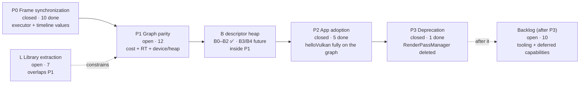
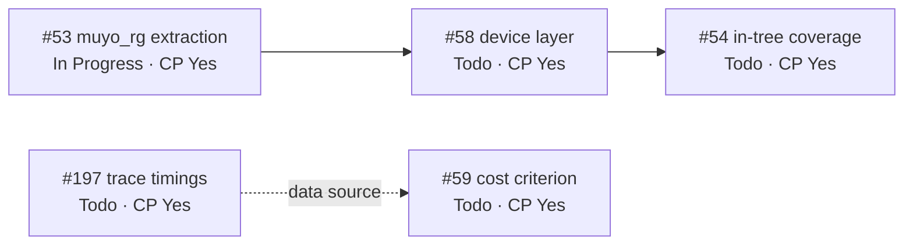

# Roadmap: a visualized snapshot

**Snapshot:** 2026-11-05, master `ada2c1d`. **Adoption is complete:** #20 and #51 are closed, the
renderer is fully graph-driven, and `src/RenderPasses/` is gone. P0, P2 and P3 are closed milestones;
P1, L and Backlog remain open with **29 open issues**. The B track is complete through B2, and the
post-adoption reconciliation added #262/#265 to P1 and moved #186 to Backlog.

**Authority:** phase membership is the six GitHub milestones; an issue's state is its `Status`,
`Critical path`, `Depends on` and `Debt` fields on the [project board](https://github.com/users/v3c70r/projects/3);
the reasoning is [`Roadmap.md`](Roadmap.md), and the consumer contract is [`Consumers.md`](Consumers.md).
This file holds none of that. It is a **view** plus the record of the reconciliation that produced it.
When the board moves, regenerate it - do not treat a diagram here as a commitment.

It is a separate file because `Roadmap.md` deliberately does not list phase members (its "Where the plan
lives" section); a diagram that listed them inside that document would recreate the duplication it warns
about. The view lives here so the contract there stays true.

---

## 1. Phases and gates



| Phase | Gate (from the milestone description) | State |
| --- | --- | --- |
| **P0** | Executor runs N in-flight executions; completion is per-queue timeline values; no frame boundary on the execution path. | **Met, closed.** 10 done, 0 open. |
| **P1** | The graph renders the scene validation-clean with the capabilities (transfer/clear, transients, descriptors, pipeline caching). RT is a separate gate. The cost half is #59. | **Open, 12.** Adoption is complete and the graph is the only renderer after #51; the per-submesh material defect (#267) was fixed by #269. Remaining: #59 cost (must choose a new reference because the legacy path is gone), the RT cluster #19/#223/#238/#253, and device/heap follow-ups #222/#233/#234/#262/#265 plus #270 (material sampler). |
| **P2** | `helloVulkan` renders through the graph; `RenderPassManager` is referenced only by its own files. Capability, not completeness. | **Met, closed.** 5 done, 0 open; the manager was deleted with #51. |
| **P3** | `grep -rn "RenderPassManager" src/` is empty and `src/RenderPasses/` is gone; the diff is almost entirely deletions. | **Met, closed.** 1 done, 0 open (#51). |
| **L** | A non-renderer consumer runs against the public surface only, with no `gap` row blocking it. | **Open, 7.** #53 (public surface) is in progress; #54 and #58 are the other critical-path items. #72 is the driver-specific blocker. |
| **Backlog** | Work the roadmap places after the first consumer adoption (complete) and P3. | **Open, 10.** None on the parity path. |

### B track inside P1

| Slice | Scope | State |
| --- | --- | --- |
| B0 (#213) | Device features, heap properties, function pointers, standalone probe, AS/RT decision | **Landed.** Same `.heap.spv` on RADV, RTX 3090 and qualifying llvmpipe; RTX 3090 RT gaps are #223/#238. |
| B1a (#215) | `DescriptorHeapService`, typed regions, static + per-execution rings, sampler lifecycle | **Landed.** Descriptors read through push data with no descriptor set/layout/pipeline layout. |
| B1b (#216) | Graph bind: `PushData`, heap index resolver, null-layout pipelines, remove descriptor-set code | **Landed.** Graph suite green; no descriptor-set/pipeline-layout calls in `src/RenderGraph/`. |
| B2 (#217) | Per-frame build, descriptor/root rings, in-flight above 1, #17/#209/#40/#83 | **Landed** (#254). #20/#51 followed; #59 is the remaining cost item. |
| B3/B4 | Unified layouts deferred; GPU-written root optional | Deferred/optional, no work now. |

## 2. Critical path

The field has **5 open items**: the library chain and P1's cost pair. Adoption has no open critical-path
item.



- **Library** — `#53` → `#58` → `#54`.
- **P1 closure** — `#197` supplies the timings; `#59` owns the method and tolerance. `#59` must name a
  reference now that the legacy path is deleted: a frozen `e584d45` worktree (with the IBL/RSM confound
  stated) or a hand-written same-four-passes harness.
- Everything else (RT, heap follow-ups, Backlog) is `Critical path: No` by the project's scoping rule.

## 3. Where the next work is

1. **Extract the library (#53).** Public surface, injected services, standalone build. #58 (device layer)
   and #54 (in-tree coverage) follow.
2. **Close P1's cost (#59).** Choose the post-adoption reference, measure on both machines, set a
   tolerance. #197 is the timing source; #59 can start against wall clock.
3. **RT, only with a consumer or when scheduled.** #19 hardening, #223 (RTX 3090 device loss), #238
   (zero hits + teardown hang), #253 (Build destroys an owned RT pipeline). These block a graph RT
   rebuild, not the deleted legacy path.
4. **Heap follow-ups.** #222 (custom-border sampler indices), #233 (NVIDIA member offsets), #234 (lazy
   builder-owned heap), #262 (NVIDIA array-member reads), #265 (dead `shaderInt64`/mesh-shader features).
5. **Backlog.** #186 (resize projection), tooling #25/#157/#183/#219/#220/#260, #144 multisampling, #188
   plan-diagram granularity.

## 4. Open issues, by milestone

| Milestone | # | Area | CP |
| --- | --- | --- | --- |
| P1 | #19 A7 RT hardening | Ray tracing | No |
| P1 | #59 cost criterion | Performance | **Yes** |
| P1 | #197 trace timings | Performance | **Yes** |
| P1 | #222 sampler index reuse | Descriptors | No |
| P1 | #223 RTX 3090 device loss | Ray tracing | No |
| P1 | #233 NVIDIA member offsets | Descriptors | No |
| P1 | #234 lazy builder heap | Descriptors | No |
| P1 | #238 RTX 3090 zero hits / hang | Ray tracing | No |
| P1 | #253 Build vs in-flight RT pipeline | Ray tracing | No |
| P1 | #262 NVIDIA array-member reads | Descriptors | No |
| P1 | #265 dead device features | Device | No |
| P1 | #270 material sampler clamp | Descriptors | No |
| L | #53 extract `muyo_rg` | Graph API | **Yes** |
| L | #54 in-tree boundary coverage | Graph API | **Yes** |
| L | #58 extract device layer | Device | **Yes** |
| L | #72 cooperative-matrix NULL dispatch | Device | No |
| L | #73 package for external use | Tooling | No |
| L | #80 8-bit storage / shaderInt8 | Device | No |
| L | #87 version the library | Tooling | No |
| Backlog | #25 `-Wconversion` / scan-build | Tooling | No |
| Backlog | #144 multisampling | Lifetime | No |
| Backlog | #157 test suite GPU fallback | Tooling | No |
| Backlog | #183 TSan report count | Tooling | No |
| Backlog | #186 resize projection | Adoption | No |
| Backlog | #188 plan-diagram granularity | Graph API | No |
| Backlog | #219 GLFW init error reporting | Tooling | No |
| Backlog | #220 RenderDoc on Wayland | Tooling | No |
| Backlog | #260 X11 close crash | Tooling | No |
| Backlog | #268 stale TODO markers | Tooling | No |

## 5. Dependencies

- `#53 → #58 → #54`: the library chain.
- `#197 → #59`: #59 consumes the timings, but can start against wall clock and switch one function.
- `#19 / #223 / #238 / #253`: the RT cluster; all block a graph RT rebuild, none blocks the raster frame.
- `#265` is independent; its TODOs are in `VkRenderDevice.cpp` and `helloVulkan.cpp`.
- `#186` is independent and Backlog; no in-tree caller remains after the resize hook was deleted with the
  legacy renderer.

## 6. Reconciliation findings (2026-11-05)

Earlier rounds (R1–R28) are in the file's history; this pass regenerated the snapshot after adoption.

| # | Finding | Evidence | Action |
| --- | --- | --- | --- |
| R29 | The roadmap still described adoption as in progress and P2/P3 as open. | #20/#51 closed; `grep -rn "RenderPassManager" src/` empty; `src/RenderPasses/` absent. | Closed P0/P2/P3 milestones; rewrote `Roadmap.md` "Where we are", phase order, risks and critical path. |
| R30 | P2 held only #186, which is not its gate. | Milestone query. | Moved #186 to Backlog; closed P2 with 0 open. |
| R31 | #59's method compared against the legacy path, which #51 deleted. | #59 body; #51. | Reframed #59 to choose and justify a new reference; retitled; updated acceptance. Roadmap P1 gate points at that choice. |
| R32 | #238 still said "resolve before deleting the legacy RT path". | #238 title/body. | Retitled and noted that the legacy path is gone; the issue remains the RTX 3090 heap-RT bug for a rebuild. |
| R33 | #262/#265 had no milestone; #265 was filed from #264 review. | Issue list. | Assigned both to P1; #265 is `Device / Fix early / Critical path No`. |
| R34 | No rebuild issues for IBL/RSM/RT were filed. | #20 close comment; user decision. | Deliberate: create them as features after the library/renderer separation. |
| R35 | Three closed items still carried `Critical path: Yes` (#48, #226, #230). | Board query. | Cleared; the field now has 5 open items, all in the library/P1 chains. |
| R36 | The TODO audit found closed-issue markers and a live material-index defect. | `grep TODO(#20)\|TODO(#48)`; `Scene.cpp:76`. | Filed #267 (submesh material index, P1; fixed by #269) and #268 (stale markers, Backlog); retargeted the three markers. |

## 7. Refreshing this view

```bash
# phase counts and open issues
gh api 'repos/v3c70r/Muyo/milestones?state=all&per_page=100' \
  --jq '.[] | "\(.title) state=\(.state) open=\(.open_issues) closed=\(.closed_issues)"'

gh issue list --state open --limit 100 --json number,title,milestone \
  --jq '.[] | "#\(.number) \(.milestone.title // "-") \(.title)"'

# critical-path count: expect 5 at this snapshot.
# Board reads need the read:project scope (`gh auth refresh -s read:project`); without it this call
# fails with "Could not resolve to a node..." — that is a missing scope, not an empty board.
gh api graphql -f query='query($p:ID!,$q:String){ node(id:$p){ ... on ProjectV2 {
  items(first:100,query:$q){ totalCount } } } }' \
  -f p=PVT_kwHOACw01s4BmAfF -f q='critical-path:Yes' --jq '.data.node.items.totalCount'

# source measurements at this snapshot
cat $(find src/RenderGraph -name '*.cpp' -o -name '*.h') | wc -l   # 8,429
wc -l src/app/helloVulkan.cpp src/app/helloVulkanRG.cpp            # 1,029 / 426
grep -rnE 'GetRenderDevice\(\)|GetRenderResourceManager\(\)|GetDescriptorManager\(\)' \
  --include=*.cpp src/RenderGraph/ | wc -l                          # 1

# External includes from src/RenderGraph/*.h|cpp; expect 9 files.
python3 - <<'PY'
import os, glob, re
d = 'src/RenderGraph'
local = set(os.listdir(d))
for f in sorted(glob.glob(d + '/*.h') + glob.glob(d + '/*.cpp')):
    inc = [m.split('/')[-1] for m in re.findall(r'^\s*#include\s+"([^"]+)"', open(f, encoding='utf-8').read(), re.M)]
    ext = [h for h in inc if h not in local and not h.startswith('vulkan')]
    if ext:
        print(f, '->', ' '.join(sorted(set(ext))))
PY
```

The singleton-site command is in `Roadmap.md`; the external-include scan is above. A copied command is a second place to rot, so the measurement lives where the claim is made.

A number in this file is a measurement with a date. If it is wrong, the fix is the command, not the
sentence.
