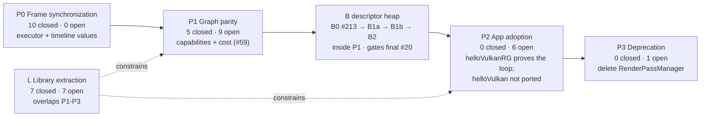
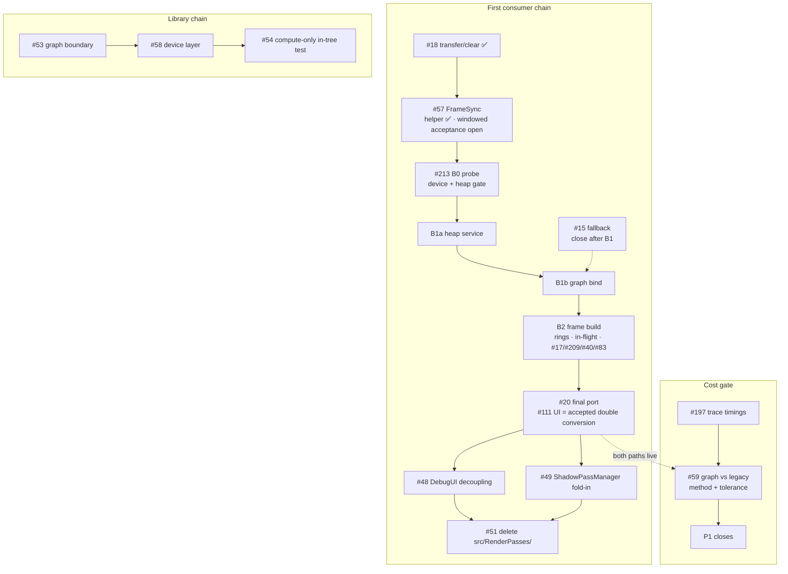
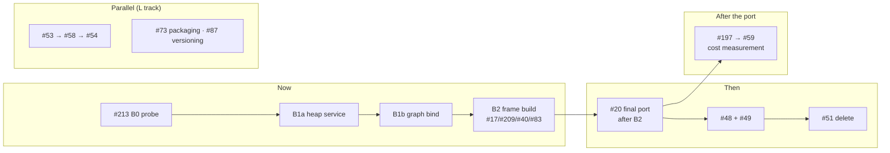
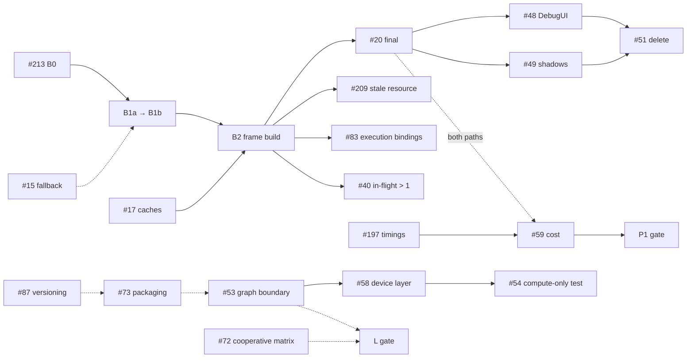

# Roadmap: a visualized snapshot

**Snapshot:** 2026-10-26, master `80465ff`. The descriptor-heap design merged in #211; #208 is closed. The
B track is #212, with B0 as #213.

**Authority:** phase membership is the six GitHub milestones; an issue's state is its `Status`,
`Critical path`, `Depends on` and `Debt` fields on the [project board](https://github.com/users/v3c70r/projects/3);
the reasoning is [`Roadmap.md`](Roadmap.md), and the consumer contract is [`Consumers.md`](Consumers.md).
This file holds none of that. It is a **view** plus the record of the reconciliation that produced it.
When the board moves, regenerate it - do not treat a diagram here as a commitment.

It is a separate file because `Roadmap.md` deliberately does not list phase members (its "Where the plan
lives" section); a diagram that listed them inside that document would recreate the duplication it warns
about. The view lives here so the contract there stays true.

---

## 1. Phases and gates



| Phase | Gate (from the milestone description) | State |
| --- | --- | --- |
| **P0** | Executor runs N in-flight executions; completion is per-queue timeline values; no frame boundary on the execution path. Builder stays `inFlightCount == 1` (#40). | **Met** - 0 open. The milestone is still open as a grouping device; closing it is an admin decision. |
| **P1** | A scene renders through the graph, validation-clean, every capability (transfer/clear, transients, descriptors, pipeline caching) matching the legacy path; RT is a separate gate. The cost half is #59. | **In progress.** #18/#16 closed, #15 fallback until B1, #17/#19/#59 open, B0/B1/B2 (#212/#213) inside P1. P1 cannot close without **#17 + #59** and the B0–B2 gate. |
| **P2** | `helloVulkan` renders through the graph; `RenderPassManager` is referenced only by its own files. Capability, not completeness. | **Started** (helloVulkanRG, increment 1: `FrameSync` + a UI node through the graph, #112/#113). The #111 UI pass is the accepted double conversion; further #20 ports freeze until B2. #48/#49 must land before #51. |
| **P3** | `grep -rn "RenderPassManager" src/` is empty and `src/RenderPasses/` is gone; the diff is almost entirely deletions. | **Blocked on P2 + #48 + #49.** |
| **L** | A non-renderer consumer runs against the public surface only, with no `gap` row blocking it. | #53 (public surface, SPIR-V bytes) and #72 (cooperative matrix fetch) are the remaining blockers. #55 and #16 landed, so their `gap` rows are now `holds` (see R4/R5). |

### B track inside P1

| Slice | Scope | Gate |
| --- | --- | --- |
| B0 (#213) | Device features, heap properties, function pointers, standalone probe, AS/RT decision | Same `.heap.spv` on RADV, RTX 3090 and qualifying llvmpipe; no `Binding`; heaps/descriptors/push data work |
| B1a | `DescriptorHeapService`, typed regions, static + per-execution rings, sampler lifecycle | Descriptors read through push data with no descriptor set/layout/pipeline layout |
| B1b | Graph bind: `PushData`, heap index resolver, null-layout pipelines, remove descriptor-set code | Graph suite green; no descriptor-set/pipeline-layout calls in `src/RenderGraph/`; UI renders |
| B2 | Per-frame build, descriptor/root rings, in-flight above 1, #17/#209/#40/#83 | Resize/swapchain rotation; overlap; #209/#40; #59 follows the final #20 |
| B3/B4 | Unified layouts deferred; GPU-written root optional | No work now |

The B track is not a phase; it is a gated workstream inside P1. B0–B2 run before the final #20 port; B3
is deferred and B4 optional. There is no G track.

## 2. Critical path



`#59` is drawn across the consumer chain rather than in it: nothing waits for it, but P1 cannot close
without its number. Its measurement needs **both** renderers alive, so the window is after the final #20
and before #51.

The B track is the descriptor chain now: #213 → B1a → B1b → B2, then the final #20. #15 is the fallback
until B1; #16/#12 are closed. #83/#40 are inside B2, not after adoption.

## 3. Where the next work is



Why this order:

1. **B0 (#213) first.** It is the go/no-go for the 1.4 + descriptor-heap platform break: device features,
   heap properties, descriptor writes, push data, AS sizing and RT null-layout acceptance. No graph
   migration starts before it.
2. **Then B1a → B1b → B2.** The heap service, graph bind and per-frame build are one workstream with
   separate gates; #17/#209/#40/#83 fold into B2.
3. **Then the final #20.** #111's UI pass is the accepted double conversion; further ports freeze until
   B2. The cost criterion (`#197 → #59`) and deletion (`#51`) follow.
4. **The L track runs in parallel**, unchanged.

## 4. Open issues, by area

Twenty-eight issues are open. `CP` is the `Critical path` field; `Deps` is the `Depends on` field.

| # | Area | Milestone | Status | CP | Deps | Note |
| --- | --- | --- | --- | --- | --- | --- |
| 15 | Descriptors | P1 | Todo | No | #213 (B0) | Fallback until B1; cache landed (#108/#109), frame retention remains. |
| 17 | Performance | P1 | Todo | **Yes** | - | Shader/reflection, layout and pipeline caches; B2 prerequisite. |
| 19 | Ray tracing | P1 | Todo | No | - | RT hardening; separate gate. |
| 40 | Synchronization | P1 | Todo | No | #15, #83 | In-flight > 1; B2 owns per-execution transients + rings. |
| 59 | Performance | P1 | Todo | Yes | #197 | Cost criterion; needs #197 and both paths. |
| 20 | Adoption | P2 | In Progress | Yes | #57 | #111 UI pass landed; #20 final port freezes until B2. |
| 48 | Adoption | P2 | Todo | No | - | DebugUI decoupling; blocks #51. |
| 49 | Adoption | P2 | Todo | No | - | ShadowPassManager into graph; blocks #51. |
| 57 | Synchronization | P2 | In Progress | Yes | - | `FrameSync` + helloVulkanRG resize landed (#110/#113); #15 is a fallback, not a gate. |
| 51 | Adoption | P3 | Todo | Yes | #20 | Deletion only. |
| 53 | Graph API | L | In Progress | Yes | - | Services injected; header split, standalone build, packaging remain. |
| 54 | Graph API | L | Todo | Yes | #58 | In-tree compute-only plan test. |
| 58 | Device | L | Todo | Yes | #53 | Device target + validation policy to the host. |
| 72 | Device | L | Todo | No | - | VVL/cooperative-matrix crash. |
| 73 | Tooling | L | Todo | No | #53 | Install rules/export set. |
| 80 | Device | L | Todo | No | - | 8-bit storage; consumer-triggered. |
| 87 | Tooling | L | Todo | No | - | Version, changelog, deprecation mechanism. |
| 83 | Graph API | P2 | Todo | No | - | Execution bindings; design #211; B2. |
| 25 | Tooling | Backlog | Todo | No | - | Remaining `-Wconversion` + scan-build baseline. |
| 144 | Lifetime | Backlog | Todo | No | - | Multisampling in `ImageResourceDesc`. |
| 157 | Tooling | Backlog | Todo | No | - | Mid-suite device fallback. |
| 183 | Tooling | Backlog | Todo | No | - | TSan report-count enforcement. |
| 186 | Adoption | P2 | Todo | No | - | `Camera::Resize` drops the new projection. |
| 188 | Graph API | Backlog | Todo | No | - | Plan-diagram granularity for consumers. |
| 197 | Performance | P1 | Todo | Yes | - | Trace timings; feeds #59. |
| 209 | Graph API | P1 | Todo | No | - | Graph-owned resource reuse after resize; B2. |
| 212 | Descriptors | P1 | Todo | Yes | - | B0–B4 tracking. |
| 213 | Device | P1 | Todo | Yes | - | B0 device + probe gate. |

## 5. Dependencies



## 6. Reconciliation findings

Each finding was checked against the repository or the board on 2026-10-22; R16–R18 were checked on
2026-10-26. The action is what this branch and the corresponding issue/field edits do.

| # | Finding | Evidence | Action |
| --- | --- | --- | --- |
| R1 | `Roadmap.md` "Where we are" line counts are stale. | `src/RenderGraph` is **7,466** lines (doc says 3,777); `src/RenderPasses` 4,412 (4,403); `helloVulkan.cpp` 376 (374). | Updated the table. |
| R2 | "The graph has zero production adoption" overstates it now. | `helloVulkan` is still legacy, but `src/app/helloVulkanRG.cpp` (330 lines) owns its frame loop through the graph, and `muyo-llm` is an external non-renderer consumer. | Reworded: zero **in-repo renderer** adoption; helloVulkanRG + muyo-llm exercise it. |
| R3 | `#83` is in `Backlog (after P3)`, but its design trigger is **after #20** (P2), which is before P3. | Design note (#211) status section; #83 body update. | Moved #83 to P2; B2 owns the execution-binding half. |
| R4 | `Consumers.md` lists "Declaration errors fail at `Build()`, naming the graph entity" as a **gap** owned by #55 - but #55 is closed. | #55 closed; the failure-index work closed as completed in the batches #127/#128/#131/#132/#135/#142 (issues, not PRs). | Row becomes `holds`. |
| R5 | The L milestone description says #55 and #16 block the gate; both are closed. | #16 and #55 are closed; the remaining gap rows are #53 (two) and #72. | Updated the milestone description. |
| R6 | `#40`'s body says descriptor sets are written at record time and depends on #15/#16/#11. Since #15's cache, sets are written at `Build()`; #16 and #11 are closed. | `docs/RenderGraph.md` status bullet says the record-time hazard is gone; the remaining alias is transients. | B2 replaces the descriptor-set half with root data; per-execution transients remain. |
| R7 | `#17` has `Critical path: No`, but the P1 gate names pipeline caching as a capability P1 cannot close without. | P1 milestone description. | Set `Critical path: Yes` (slippage moves P1's close). |
| R8 | `#53`'s measurements are stale (13 files / 15 call sites / "no `target_link_libraries`"), and it still depends on #11 (closed). | Now **8** files under `src/RenderGraph/` include at least one header from outside the directory (scan in section 7), **2** singleton code call sites in the transitional constructor (+3 doc lines), and `muyo_rg` has `target_link_libraries(PUBLIC muyo)`. | Updated #53's body; cleared the closed dependency. |
| R9 | `#25` is titled "Enable -Wextra ...", but `-Wextra` and the warning baseline landed (#193/#194). Only `-Wconversion` measurement and the scan-build baseline remain. | #25's own status section. | Retitled to the remaining scope; kept `Debt: After P3`. |
| R10 | Seven open issues have **no milestone**, so the Roadmap's "milestone owns the phase" contract does not cover them: #144, #157, #183, #186, #188, #197, #209. | `gh issue list` vs milestones. | Assigned: #197/#209 to P1, #186 to P2, #144/#157/#183/#188 to Backlog. |
| R11 | The `Depends on` field for #59 is empty although #59 consumes #197's timing data; #57 listed closed #16 and then the #15 fallback. | #59 body, #197 body, #57 board field. | Set #59 → #197; cleared #57 to none — #15 is a fallback, not a gate. |
| R12 | `docs/RenderGraph-Library-Design.md` still says `muyo_rg` declares no dependencies, while it now links the engine. | `CMakeLists.txt:366 target_link_libraries(muyo_rg PUBLIC muyo)`. | Corrected the sentence: the remaining gap is standing alone, not declaring nothing. |
| R13 | The Roadmap's "Not on the parity path" table still lists #22/#24 (closed) and #25 (landed except two items). | #22 and #24 closed; #25 status section. | Table updated: #25's remaining scope only. |
| R14 | P0 has 0 open issues but the milestone is still open. | Milestone counts. | Left open as a grouping device; noted here so it is a decision rather than an oversight. |
| R15 | The Roadmap's Risk 5 says CI gates "formatting"; CI now also runs the changed-line clang-tidy gate. | `.github/workflows/ci.yml` has a `clang-tidy (changed lines)` job and 7 jobs total. | Added to Risk 5. |
| R16 | The roadmap still described the descriptor path as #15 and referenced PR #208 as the execution-bindings design. #211 merged the descriptor-heap design and #208 closed. | `docs/DescriptorHeap-Bindless-Design.md`; PR #211; issue #208. | Added B0–B4 to `Roadmap.md`, added the B track to the visual, and moved #83/#40 references to #211/B2. |
| R17 | P1 count and total open issues changed when the B tracking and B0 issues were filed. | Milestones: P1 open 9; 28 open total. | Updated the snapshot, phase counts and issue table. |
| R18 | #20 has in-flight work (#111 UI) but no freeze statement; the roadmap read as if porting had not started. | #111 merged; #20 open. | Recorded #111 as accepted double conversion and froze further ports until B2. |

## 7. Refreshing this view

```bash
# phase counts
gh api 'repos/v3c70r/Muyo/milestones?state=all&per_page=100' \
  --jq '.[]|"\(.title): open=\(.open_issues) closed=\(.closed_issues)"'

# issue state, including the custom fields (the key has a space: "critical path"). Board reads need
# the read:project scope (gh auth refresh -s read:project); without it the command fails, which is not
# the same as an empty board.
gh project item-list 3 --owner v3c70r --limit 200 --format json \
  | python3 -c 'import json,sys; [print(i["content"]["number"], i.get("status"), i.get("critical path"), i.get("depends on")) for i in json.load(sys.stdin)["items"] if i.get("content",{}).get("number")]'

# the measurement claims in section 6
cat $(find src/RenderGraph -name '*.cpp' -o -name '*.h') | wc -l
grep -rnE 'GetRenderDevice\(\)|GetRenderResourceManager\(\)|GetDescriptorManager\(\)' --include=*.cpp src/RenderGraph/ | wc -l
# -> 2. Without --include=*.cpp it prints 5: the two code sites plus three doc-comment lines in the header.
grep -n 'target_link_libraries(muyo_rg' CMakeLists.txt

# The include scan behind R8/R12: quoted includes that are not files in src/RenderGraph/.
python3 - <<'PY'
import os, glob, re
d = 'src/RenderGraph'
local = set(os.listdir(d))
for f in sorted(glob.glob(d + '/*.h') + glob.glob(d + '/*.cpp')):
    inc = [m.split('/')[-1] for m in re.findall(r'^\s*#include\s+"([^"]+)"', open(f, encoding='utf-8').read(), re.M)]
    ext = [h for h in inc if h not in local and not h.startswith('vulkan')]
    if ext:
        print(f, '->', ' '.join(sorted(set(ext))))
PY
# 8 files at this head; the largest sets are RenderGraphBuilder.cpp (4) and RenderGraphBuilder.h (3).
```

A number in this file is a measurement with a date. If it is wrong, the fix is the command, not the
sentence.
